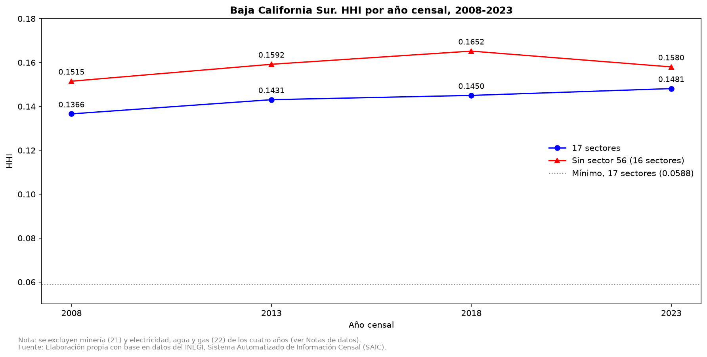
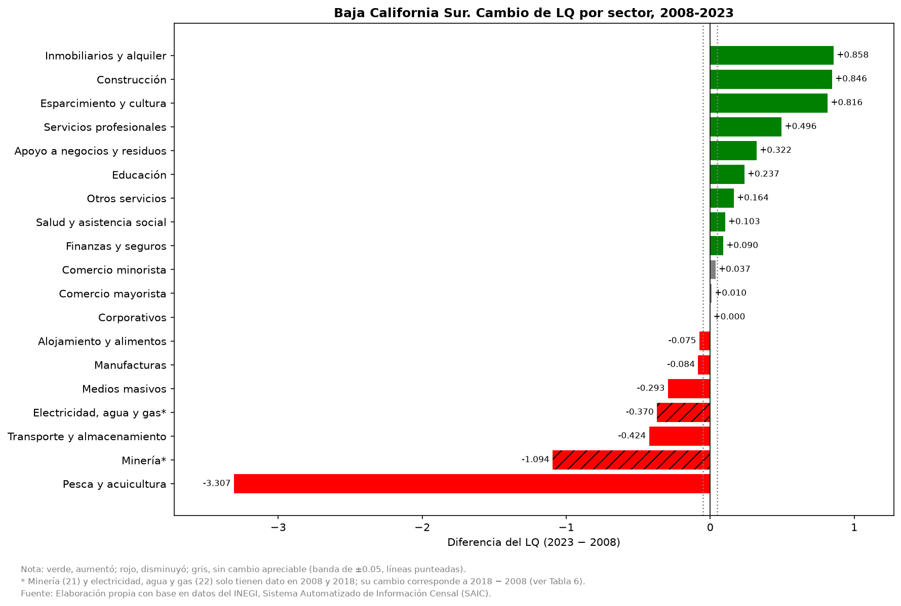

# Coeficiente de localización de Baja California Sur, 2008-2023

Este proyecto describe en qué sectores pesa más el empleo de Baja California Sur (BCS) que el del país, cuántos empleos tiene el estado por encima de lo esperado según la estructura nacional y cómo cambiaron la concentración del empleo y la especialización relativa entre 2008 y 2023. Usa el personal ocupado total de los Censos Económicos de INEGI y el coeficiente de localización (LQ). Es un análisis descriptivo: compara pesos relativos de empleo, no estima modelos y no establece causas.

El análisis completo está en el notebook; este README es un resumen.

## Contenido

- [Preguntas que responde](#preguntas-que-responde)
- [Resultados principales](#resultados-principales)
- [Alcance](#alcance)
- [Fuente de los datos](#fuente-de-los-datos)
- [Metodología](#metodología)
- [Estructura del proyecto](#estructura-del-proyecto)
- [Requisitos y ejecución](#requisitos-y-ejecución)
- [Limitaciones](#limitaciones)
- [Referencias](#referencias)
- [Autoría y licencia](#autoría-y-licencia)

## Preguntas que responde

1. ¿En qué sectores pesa más el personal ocupado en Baja California Sur que en el país (LQ > 1) en cada año censal, entre 2008 y 2023?
2. ¿Cuántos empleos por encima del esperado tiene cada sector de Baja California Sur en cada año censal, según la estructura nacional?
3. Entre 2008 y 2023, ¿el empleo de Baja California Sur se diversificó o se concentró entre sectores?
4. ¿En qué sectores aumentó y en cuáles disminuyó la especialización relativa entre 2008 y 2023? (Para los sectores 21 y 22, la comparación abarca de 2008 a 2018.)

## Resultados principales

**1. Sectores con LQ > 1**

- Los sectores con LQ > 1 fueron 7 de 19 en 2008, 10 de 17 en 2013, 7 de 19 en 2018 y 8 de 17 en 2023. Los conteos no son comparables entre años porque cambia el universo (ver [Metodología](#metodología)).
- Cuatro sectores superan el peso nacional en los cuatro años: pesca y acuicultura, alojamiento y alimentos, inmobiliarios y alquiler, y construcción. Pesca y acuicultura es el sector más especializado en todos los años (LQ entre 7.255 y 3.737).
- Varios LQ apenas superan 1 (por ejemplo, otros servicios en 2018, con 1.004), por lo que no indican una especialización clara.
- Un LQ alto no implica un sector grande: en 2018, minería tiene el cuarto LQ más alto (2.568) con 4,061 personas, mientras que comercio minorista, con un LQ de 0.916, emplea a 44,805.

**2. Empleo excedente**

- 14 sectores tienen empleo excedente en al menos un año censal.
- Alojamiento y alimentos tiene el mayor excedente en los cuatro años (18,820 personas en 2008, 21,770 en 2013, 38,737 en 2018 y 32,695 en 2023) y en cada año supera la suma del excedente de todos los demás sectores (entre 51.8% y 66.8% del total).
- El empleo excedente es relativo a la estructura nacional: no demuestra que un sector produzca para fuera del estado.

**3. Concentración del empleo (HHI)**

| | 2008 | 2013 | 2018 | 2023 |
|---|:---:|:---:|:---:|:---:|
| HHI (17 sectores) | 0.1366 | 0.1431 | 0.1450 | 0.1481 |
| HHI sin sector 56 (16 sectores) | 0.1515 | 0.1592 | 0.1652 | 0.1580 |



- Con 17 sectores, el HHI sube 8.4% entre 2008 y 2023: el empleo se reparte como si fuera entre 7.3 sectores iguales en 2008 y entre 6.8 en 2023 (de un máximo de 17). Comercio minorista y alojamiento y alimentos concentran entre 46.4% y 49.9% del empleo.
- El aumento viene de alojamiento y alimentos, cuya participación pasa de 22.0% a 25.8%.
- Sin el sector 56, el HHI sube hasta 2018 y baja en 2023, y el cambio de todo el periodo es de +4.3%. El aumento hasta 2018 se mantiene con y sin ese sector; el de 2018 a 2023 depende de él, por lo que no se puede afirmar que la concentración siga creciendo.

**4. Cambio en la especialización relativa**

- Entre 2008 y 2023, el LQ aumenta en 9 sectores, disminuye en 5 y no cambia de forma apreciable en 3 (comercio minorista, comercio mayorista y corporativos).
- Los mayores aumentos son inmobiliarios y alquiler (+0.858), construcción (+0.846) y esparcimiento y cultura (+0.816). Cuatro sectores pasan de un LQ menor a 1 a uno mayor a 1: esparcimiento y cultura, servicios profesionales, apoyo a negocios y residuos, y otros servicios.
- Pesca y acuicultura registra la mayor caída (−3.307, de 7.255 a 3.948) y sigue como el sector más especializado. Transporte y almacenamiento pasa de 1.226 a 0.802.
- Minería (de 3.662 a 2.568) y electricidad, agua y gas (de 1.346 a 0.977) disminuyen entre 2008 y 2018; no hay dato para 2013 y 2023.



## Alcance

**Incluye**

- Personal ocupado total (H001A) de los Censos Económicos, por sector SCIAN a dos dígitos.
- Baja California Sur frente al Total Nacional, en los años censales 2008, 2013, 2018 y 2023.
- Coeficiente de localización, empleo esperado y excedente, e índice de Herfindahl-Hirschman (HHI).

**No incluye**

- Causas de los cambios ni explicaciones de por qué un sector pesa más o menos.
- Productividad, salarios o valor agregado: la variable cuenta personas.
- Actividades gubernamentales ni agropecuarias y forestales (del sector 11 solo se capta pesca y acuicultura).
- Comparaciones con otros estados ni el año censal 2003.

## Fuente de los datos

Los datos provienen de INEGI, Censos Económicos 2024 (resultados definitivos, cifras corregidas el 5 de septiembre de 2025), consultados en el Sistema Automatizado de Información Censal (SAIC): <https://www.inegi.org.mx/app/saic/default.html>

| | |
|---|---|
| **Archivo** | `data/datos_bcs.csv` |
| **Variable** | H001A Personal ocupado total (personas) |
| **Años de referencia** | 2008 (CE 2009), 2013 (CE 2014), 2018 (CE 2019) y 2023 (CE 2024) |
| **Áreas geográficas** | 00 Total Nacional y 03 Baja California Sur |
| **Actividad económica** | Todos los sectores, sin totales |
| **Fecha de consulta** | 7 de octubre de 2026 |

**Notas sobre los datos**

- El sector 55 no aparece como fila en Baja California Sur en ningún año. Como INEGI indica que muestra todos los renglones existentes, se infiere que el estado no tiene unidades económicas en ese sector, y el análisis le asigna cero.
- Los sectores 21 (minería) y 22 (electricidad, agua y gas) tienen celdas vacías en 2013 y 2023: INEGI omite esos datos por confidencialidad. El análisis los excluye de esos años y no infiere su tamaño.
- INEGI puede revisar sus cifras; si consultas los datos en otra fecha, los resultados pueden variar.

## Metodología

- **LQ** = (empleo del sector en BCS / empleo total de BCS) / (empleo del sector a nivel nacional / empleo total a nivel nacional). Un valor mayor que 1 indica que el sector pesa más en el empleo estatal que en el nacional.
- **Empleo esperado** = (empleo del sector a nivel nacional / empleo total nacional) × empleo total de BCS. **Empleo excedente** = empleo real en BCS − empleo esperado.
- **Universo de cada año.** Los totales suman los mismos sectores en el numerador y en el denominador: 19 sectores en 2008 y 2018, y 17 en 2013 y 2023 (sin los sectores 21 y 22).
- **HHI** = suma de los cuadrados de la participación de cada sector (en proporción) en el personal ocupado de BCS, sobre los 17 sectores con dato en los cuatro años. Su mínimo es 0.0588 (1/17). Una variante excluye el sector 56 (mínimo de 0.0625) para probar la sensibilidad del resultado.
- **Cambio de especialización (pregunta 4).** Diferencia del LQ entre 2023 y 2008, con una banda de ±0.05 para "sin cambio apreciable". La banda es un criterio propio, no una prueba estadística.

El detalle y las decisiones metodológicas están en el notebook.

## Estructura del proyecto

```
coeficiente_localizacion/
├── data/
│   └── datos_bcs.csv
├── figures/
│   ├── grafica_01_hhi_por_anio.png
│   └── grafica_02_cambio_lq_por_sector.png
├── notebook/
│   └── coeficiente_localizacion_bcs.ipynb
├── .gitignore
├── LICENSE
├── README.md
└── requirements.txt
```

## Requisitos y ejecución

El análisis se desarrolla en un Jupyter Notebook, que se ejecuta desde Visual Studio Code con la extensión de Jupyter.

| Herramienta | Versión |
|---|---|
| Python | 3.15.1 |
| pandas | 3.0.6 |
| matplotlib | 3.11.2 |
| ipykernel | Última disponible |

1. Clona el repositorio y entra a la carpeta:

   ```bash
   git clone https://github.com/Jose-Castanedas/coeficiente_localizacion.git
   cd coeficiente_localizacion
   ```

2. Crea y activa un entorno virtual:

   ```bash
   python -m venv .venv
   source .venv/bin/activate      # En Windows: .venv\Scripts\activate
   ```

3. Instala las dependencias:

   ```bash
   pip install -r requirements.txt
   ```

4. Abre `notebook/coeficiente_localizacion_bcs.ipynb` en Visual Studio Code, selecciona el kernel del entorno `.venv` y ejecuta todas las celdas.

El notebook lee los datos con rutas relativas (`../data/`) y guarda las gráficas en `../figures/`, por lo que debe ejecutarse desde la carpeta `notebook/`. Visual Studio Code lo hace así por defecto. El proyecto se desarrolló con Python 3.14.2 y se ejecutó de nuevo sin errores con Python 3.15.1; no se probó con otras versiones.

## Limitaciones

- El LQ compara pesos relativos y no mide el tamaño de los sectores: un LQ alto con pocos empleos no indica una especialización consolidada, y un cambio en el LQ puede venir del estado o del país.
- El empleo excedente es relativo a la estructura nacional y no demuestra que un sector produzca para fuera del estado; explicar sus causas requiere fuentes externas.
- El universo cambia entre años (de 19 a 17 sectores), por lo que los conteos y las diferencias entre años no son estrictamente comparables.
- El sector 56 tiene problemas de comparabilidad entre 2018 y 2023: INEGI excluye la rama 5613 (servicios de empleo) de su serie comparable de personal ocupado por los cambios de la reforma de subcontratación de 2021, y el análisis la incluye. Su LQ sube porque el empleo nacional del sector cae más (−67%) que el estatal (−59%). Esto afecta a las preguntas 1, 3 y 4.
- El HHI mide concentración y no especialización, y los sectores SCIAN de dos dígitos ocultan la concentración dentro de cada sector.
- La banda de ±0.05 es un criterio propio, y comparar solo 2008 y 2023 esconde cambios intermedios.
- El sector 11 solo capta pesca y acuicultura, y el universo es el sector privado y paraestatal.
- El cero del sector 55 es una inferencia.

## Referencias

- INEGI. (2025, enero). *Resultados oportunos de los Censos Económicos 2024* [Presentación de conferencia de prensa]. https://inegi.org.mx/contenidos/programas/ce/2024/doc/ro_pcp_ce2024.pdf
- Instituto Nacional de Estadística y Geografía. (2024). *Sistema Automatizado de Información Censal (SAIC): Metodológico. Censos económicos 2024*. https://www.inegi.org.mx/contenidos/app/saic/saic_historico_metodologico_ce2024.pdf
- Instituto Nacional de Estadística y Geografía. (2024). *Sistema Automatizado de Información Censal (SAIC): Censos Económicos 2024* [Base de datos]. Consultado el 7 de octubre de 2026. https://www.inegi.org.mx/app/saic/default.html
- U.S. Department of Justice, Antitrust Division. (2024, 17 de enero). *Herfindahl-Hirschman Index*. https://www.justice.gov/atr/herfindahl-hirschman-index

## Autoría y licencia

Autor: Jose Guadalupe Castañeda Soto

El código de este proyecto se publica bajo la licencia MIT (ver el archivo `LICENSE`). Los datos pertenecen a INEGI y se rigen por sus propios términos de uso.